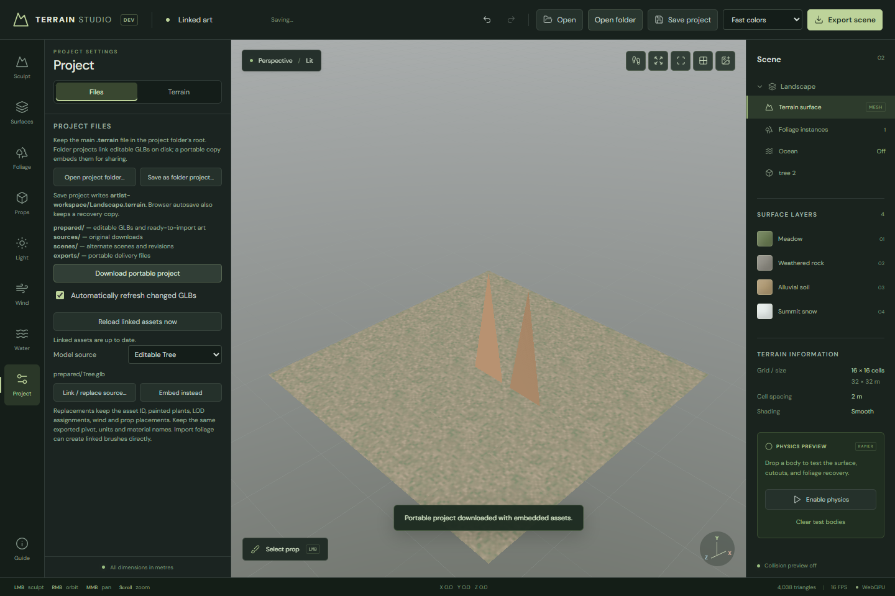

# Project folders

An artist's landscape has a **root `.terrain` document** and editable art alongside it. Folder projects link GLB files; exporting over a linked file refreshes its foliage, LODs and props automatically. Portable project downloads embed the current art for sharing. Both use the same editor/runtime and keep project artwork outside `src/` and `public/`.

Keep each content project in its own directory, preferably outside the toolkit checkout:

```text
Documents/
  GitHub/terrain-tools/          # Editor, runtime, tests and general documentation
  Terrain Studio Projects/
    My Landscape/
      My-Landscape.terrain      # OPEN THIS: the main editable project
      README.md                 # Open/rebuild instructions and known limits
      CREDITS.md                # Artists, links, licenses and modifications
      content-manifest.json     # Content manifest, units, versions and checksums
      sources/                  # Original downloads and DCC authoring files
      prepared/                 # Editable GLBs, texture sets and heightmaps
      scenes/                   # Alternate scenes and named editable revisions
      tools/                    # This project's conversion/build scripts
      exports/                  # GLBs, baked maps and other delivery files
      evidence/                 # Optional validation logs and screenshots
```

The **main `.terrain` file belongs in the root**, like a solution/project file in a desktop tool. Open it directly with **Open** in Terrain Studio. Use one clearly named main document; put lighting studies, alternate scenes and named revisions in `scenes/`. `exports/` is for delivery output, not the working project. Create supporting directories only as needed.

**Open folder** grants the editor access to that project directory. **Save project** then updates its root document directly. Version-2 folder packages store relative GLB references and import settings without embedding those linked models. **Download portable project** creates a version-1 self-contained snapshot with source links removed. Existing portable/native/legacy projects remain readable. `content-manifest.json` remains optional supporting inventory; use `"kind": "terrain-content-manifest"` and `"project": "My-Landscape.terrain"`. The actual document contains the scene and asset bindings.

The Project tab explains the layout and saving behavior:



## Create a project folder

From the toolkit checkout, with Node 22.12+ (Node 24 used for development):

```powershell
npm ci
npm run build:runtime
npm run project:create -- "C:/Users/your-name/Documents/Terrain Studio Projects/My Landscape"
npm run dev
```

The path must be a **new folder** inside an existing parent. The command creates a 256 m, 128 × 128 cell folder project, a root `.terrain` file, credit/inventory/readme files and supporting directories (except optional `evidence/`). It installs no dependencies in the content folder and refuses existing folders, including empty ones. In the editor, choose **Open folder** and select the printed directory.

You can also use **Project → Files → Save as folder project** to save the current landscape into a new directory. It extracts embedded models as editable GLBs under `prepared/models/` and writes a linked root document. Existing project directories are opened rather than overwritten by this command.

## Work in the editor

1. Run `npm ci` once in the toolkit checkout, then `npm run dev`. Open Vite's printed Local URL.
2. Choose **Open folder**, selecting the directory containing one root `.terrain` file. Existing embedded projects open this way too. For old projects, **Project → Files → Make embedded models editable** extracts their GLBs and adds source links. The first save of an existing portable document preserves its old bytes in `scenes/*-before-links-*.terrain`.
3. **Save project** writes the connected root document. Browser autosave separately keeps a complete recovery snapshot, including the last working model bytes and link metadata. After a browser restart, use **Reconnect recovered project folder** to preserve recovered unsaved edits while reauthorizing access. **Open folder** deliberately loads the disk document. A file-only **Open** remains available for portable projects; its Save downloads a portable file.
4. In **Foliage → Library → Import foliage**, choose **Choose linked GLBs from project**. Export self-contained GLBs into `prepared/foliage/` (or another project-local folder) from your DCC, then select them. Review size, units, pivot and brush behavior normally. The retained import transform applies to later exports. The usual file/folder importer still supports embedded GLB/glTF+BIN+texture imports. Import terrain PBR sets from `prepared/`, retaining downloads/licenses in `sources/`; standalone terrain-map linking is not implemented yet.
5. Keep revisions as separate named files or use a dedicated content repository with appropriate large-file storage. Back up both the editable document and the original authoring sources.

Use **Save surface**, **Save brush**, and sculpt presets for reusable content across projects. Keep those files in the content library, then load them through the normal editor controls. The toolkit need not contain a named scene button, a hardcoded local path, or a dependency on a particular artist's asset pack.

## Iterate on linked art

Export over the displayed GLB path. The editor polls metadata every two seconds while visible and idle, and waits for two stable observations before reading changed bytes. Fresh path lookups support atomic file replacement. New GPU resources stage before the live scene changes; asset IDs, placements, brush behavior and LOD references remain stable. Keep the exported units/pivot and material names consistent. The original import's scale/offset is retained, rather than refitting each revision.

Incomplete, missing or undecodable models leave the last working art, history and recovery copy intact. Completing a new export changes the file stamp and retries automatically. **Reload linked assets now** forces a reread/retry, including for tools that preserve timestamps. Disable automatic refresh when freezing art for review. One undo restores a refreshed art version without writing back to the GLB; unchanged disk files do not silently redo that undo.

**Project → Files → Model source** shows each model's path, including assets used by props and LODs. **Link / replace source** retargets the existing asset ID; **Embed instead** detaches it and preserves its current bytes in the project. Linked sources must be self-contained project-local GLBs. Their embedded textures/materials refresh with the model. Direct `.gltf` dependency watching, loose terrain PBR maps, HDR/EXR source links and cross-project absolute links remain future work.

Folder access uses desktop Chrome/Edge's [File System Access API](https://developer.chrome.com/docs/capabilities/web-apis/file-system-access). Only chosen directories are accessed; opening a single File does not grant sibling-file access. Native-picker permission dialogs are controlled by the browser. Document writes publish on stream close and reject detected external file changes; save a portable copy or reopen the folder to resolve a conflict.

## Reorganize an existing project

Move the main document from `exports/` to the root **without regenerating it**. Put other editable scene variants in `scenes/`, and update `project` / `sourceProject` paths in their manifests. Keep source art, prepared assets, credits, undoable authoring data and original filenames intact. Update local build/validation scripts and README links to use the new paths; builders should refuse to overwrite an artist-edited document. Preserve the manifests' generation checksums: moving a file does not change its bytes, and an edited document must not be relabeled as an untouched generated output. Historical evidence can retain its original paths.

The local Namaqualand, Pine Forest and Tropical Grove projects now use this layout. Namaqualand's lighting variants are in `scenes/`. Their art stays outside this repository. The forest inventory lookup accepts both root documents and the old one-level `exports/` arrangement.

## Convert a DCC scene

A Blender or Unreal scene is not automatically an editable heightfield. Bake a bounded, single-valued terrain surface to PNG16/RAW16 or construct the core height buffer in a project script. Record physical dimensions, elevation range, axis conversion and any excluded overhangs. Keep cliffs and other non-heightfield forms as separate props.

Prepare static GLBs with embedded standard PBR textures and usable pivots. Convert Blender procedural/translucent materials and engine-specific shaders deliberately; the native document does not execute those shaders. Terrain maps use PNG/JPEG/WebP with numeric channels packed into ORM; HDR/EXR support is for environment panoramas. Retain original files and document approximation, reduction and color-space decisions.

For a scripted build, run `npm run build` in the toolkit checkout, then import its public `lib/core.js` from the external project's script. `createProject`, `serializeProjectPackage`, and `parseProjectFile` provide document construction and validation. Accept the toolkit path as a script argument rather than modifying app source. Run the script from the content project; use the toolkit's existing locked dependencies where required and record their versions. No additional application package or plugin is necessary.

Validate the native package, then open it in a fresh browser profile, inspect close and distant views, and save/reopen it. Check real asset memory and frame cost; file admission limits are not GPU performance guarantees. Keep evidence with the content project and promote only reusable fixes or concise general findings into the toolkit. See [file limits and recovery](PROJECT-FILES.md), [material import](MATERIALS.md), and [foliage import](FOLIAGE.md).

## Sharing and hosting

Share a **portable project download** with credits for a self-contained snapshot. Share the whole folder for continued art iteration: a linked `.terrain` alone does not contain its models. The runtime can load a portable native Blob/ArrayBuffer directly. Hosts can resolve linked files with `readProjectFile(file, source => ...)` and `prepareLinkedModel(bytes, source)`, then pass the hydrated project to `loadTerrain`. `scripts/read-content-project.mjs` provides a read-only Node adapter with bounded, project-local file access. The tropical benchmark snapshots current source art into its portable payload and fingerprint.

Directory handles stay in the editor session and are never serialized as absolute paths. A recent-project library, automatic OS-wide watching and loose PBR-map links remain unimplemented. Current linked models retain the existing 320 MiB per-model and 384 MiB aggregate live-asset admission limits; linking reduces disk duplication, not decoded/GPU memory. Credits and original DCC authoring files remain part of the project directory.

Verification covers 378 unit tests, ten targeted Chrome cases and a final three-case linked-workflow rerun. A copied Tropical Grove scene refreshed a linked banana GLB on the RTX 5060 while preserving all 37 models and 7,323 plants in its expected portable snapshot. Its working document was 17,221,704 bytes, with linked model payloads stored separately, versus 55,176,040 bytes for the original embedded document. The original content stayed unchanged. Native browser filesystem handles are exercised with picker functions stubbed; OS permission-dialog automation and other devices remain unverified. See [recorded checks and limits](benchmarks/linked-assets-2026-10-20.json).
